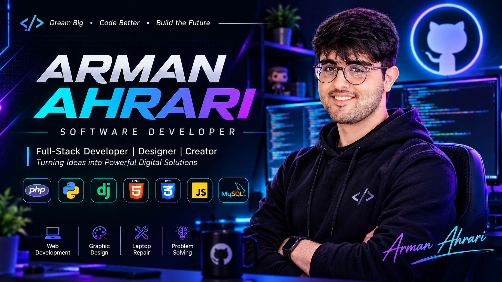

 

 

---

## 👨‍💻 About Me

Hi! I'm **Arman Ahrari**, a Computer Engineering graduate specializing in IT, passionate about programming, technology, and creative design.

- 💻 Web Development with PHP and Python.
- 🐍 Experience with Django and Backend Development.
- 🌐 HTML, CSS and MySQL.
- ⚡ Currently learning JavaScript.
- 🎨 Graphic Designer with experience in Photoshop, Illustrator, CorelDRAW and Canva.
- 🔧 Laptop Hardware & Software Repair.
- 🚀 Always learning and exploring new technologies.

---

## ⚡ Tech Stack

### Programming & Development

### Design & Creativity

**CorelDRAW • Canva • Graphic Design**

---

## 🎯 What I'm Working On

- Learning and practicing JavaScript.
- Improving my backend development skills.
- Building websites and practical projects.
- Exploring new technologies.

---

## 🛠️ Other Skills

Team Management • Teamwork • Problem Solving  
Creative Thinking • Customer Communication  
Laptop Hardware & Software Repair

---

## 🤝 Connect With Me

 

### ⚡ THINK • CODE • CREATE • REPEAT ⚡

